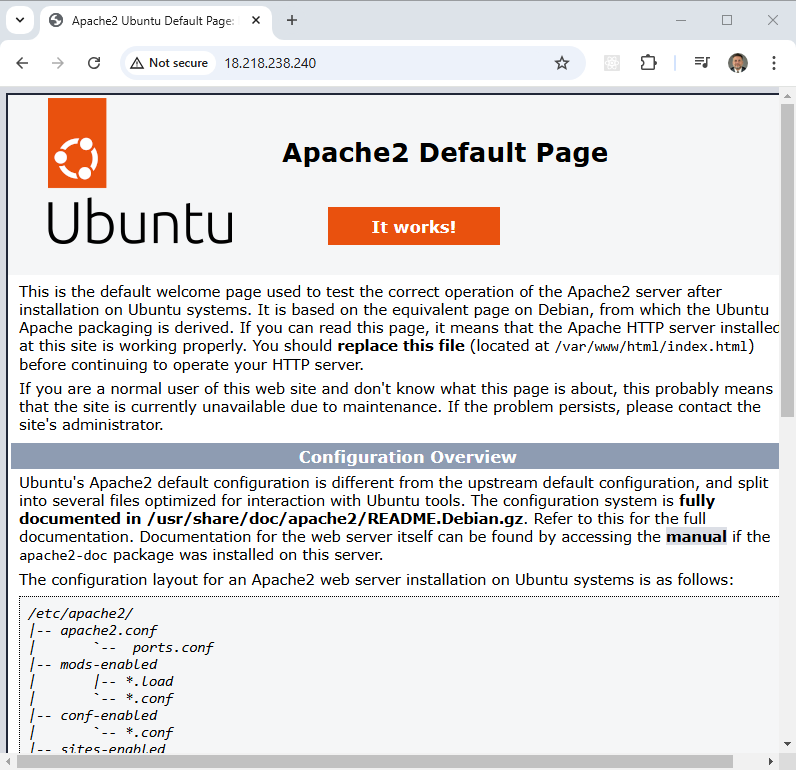
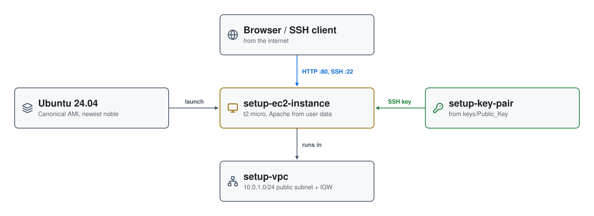

# AWS + Terraform Setup

The companion project to the
[AWS + Terraform: Easy Setup](https://youtu.be/42ynVALwFk8) video. It shows how
to give Terraform access to an AWS account, then proves the setup works by
building the smallest useful thing: a VPC with one public subnet and an
Ubuntu EC2 instance running Apache.



| Piece | Where | Role |
|---|---|---|
| **setup-ec2-instance** | `setup-public-subnet` (10.0.1.0/24, us-east-2a) | `t2.micro`, Canonical's newest Ubuntu 24.04 AMI; user data installs Apache; public IP |
| **setup-vpc** | us-east-2 | 10.0.0.0/16, with an internet gateway and a route table for the public subnet |
| **setup-security-group** | `setup-vpc` | 22 and 80 from anywhere |
| **setup-key-pair** | regional | the public half of `keys/Public_Key`, for SSH |

## Architecture

<picture>
  <source media="(prefers-color-scheme: dark)" srcset="architecture-dark.svg">
  
</picture>

Regenerate with `python3 make_diagram.py`.

Everything is in `main.tf`. `scripts/userdata.sh` installs and starts
Apache. Bash and PowerShell versions of each script are included.

## Give Terraform access to AWS

You need an AWS account; the [Free Tier](https://aws.amazon.com/free/) is
enough for this project.

1. Sign in to the [AWS Management Console](https://aws.amazon.com/console/)
   as a user that can create access keys, and open **IAM**.
2. Create a user for Terraform (for example `terraform-user`), or pick an
   existing one. Attach `AdministratorAccess` for full access, or a custom
   policy limited to what Terraform will manage.
3. On the user's **Security credentials** tab, under **Access keys**, choose
   **Create access key**. Save the **Access Key ID** and **Secret Access
   Key**: the secret is shown only once.
4. Export them:

   ```bash
   export AWS_ACCESS_KEY_ID="your_access_key_id"
   export AWS_SECRET_ACCESS_KEY="your_secret_access_key"
   export AWS_DEFAULT_REGION="us-east-2"
   aws sts get-caller-identity
   ```

   ```powershell
   $env:AWS_ACCESS_KEY_ID = "your_access_key_id"
   $env:AWS_SECRET_ACCESS_KEY = "your_secret_access_key"
   $env:AWS_DEFAULT_REGION = "us-east-2"
   aws sts get-caller-identity
   ```

## Prerequisites

* [Install AWS CLI](https://docs.aws.amazon.com/cli/latest/userguide/getting-started-install.html)
* [Install Terraform](https://developer.hashicorp.com/terraform/install)
* [Install Packer](https://developer.hashicorp.com/packer/install)

`check_env.sh` checks that `aws`, `packer` and `terraform` are on your
`PATH` (Packer isn't used here, but the later projects need it) and that the
AWS CLI can authenticate.

## Deploy

```bash
git clone https://github.com/mamonaco1973/aws-setup.git
cd aws-setup
./apply.sh       # or .\apply.ps1
```

The instance is created in `us-east-2`; Terraform prints its address as
`setup_ec2_public_ip`.

## Try it

1. Open `http://<setup_ec2_public_ip>`. Apache's test page appears once the
   user data has finished, which can take up to 5 minutes.
2. SSH in with the project's key:

   ```bash
   ssh -i keys/Private_Key ubuntu@<setup_ec2_public_ip>
   ```

## Teardown

```bash
./destroy.sh     # or .\destroy.ps1
```

## Notes

- **Lab only.** SSH and HTTP are open to the internet, and the SSH key pair
  in `keys/` is committed to this public repository, so anyone can use the
  private key. Generate your own key pair and restrict the security group
  for anything more.
